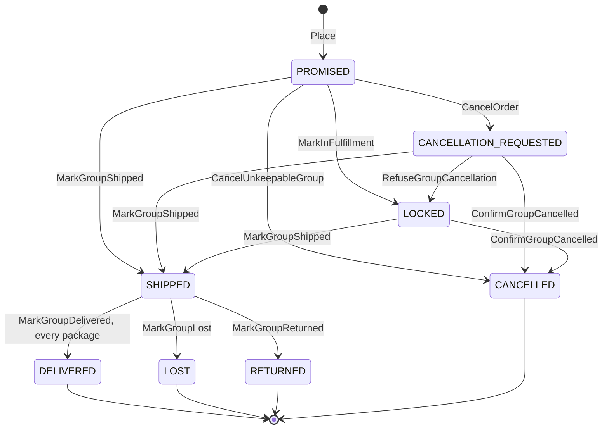

# Aggregate design canvas

Following the ddd-crew [Aggregate Design Canvas v1.1](https://github.com/ddd-crew/aggregate-design-canvas)
for the two aggregates of the context: **CustomerOrder** (root of the order, its
lines and its shipment groups) and **Shopper** (root of the account and its saved
addresses). The tracking read model (`internal/application/readmodel`) is a set of
plain upserts, not an aggregate, and `ShipTo` is a value object.

## CustomerOrder

Source: `internal/domain/customerorder/{order,place,cancel,commands,status,restore}.go`,
ADR [0002](/docs/adr/0002-aggregates-and-invariants).

| Canvas section | Content |
| --- | --- |
| **Name** | `CustomerOrder` (table `customer_orders` with `order_lines` and `order_groups`) |
| **Description** | A shopper's order: lines, a ship-to snapshot, one promise per shipment group and the customer-facing status derived from the group states. |
| **State** | order: `PLACED`, `IN_FULFILLMENT`, `PARTIALLY_SHIPPED`, `SHIPPED`, `PARTIALLY_DELIVERED`, `DELIVERED`, `LOST`, `RETURNED`, `CANCELLED`; group: `PROMISED`, `LOCKED`, `SHIPPED`, `DELIVERED`, `LOST`, `RETURNED`, `CANCELLATION_REQUESTED`, `CANCELLED` |
| **Enforced invariants** | see below |
| **Corrective policies** | `CancelOnUnfulfillable`: `PromiseUnkeepable` cancels the `PROMISED` group; stale or impossible events are skipped, not retried (ADR 0002 A7) |
| **Handled commands** | `Place`, `CancelOrder`, `CancelUnkeepableGroup`, `ConfirmGroupCancelled`, `RefuseGroupCancellation`, `MarkInFulfillment`, `MarkGroupShipped`, `MarkGroupDelivered`, `MarkGroupLost`, `MarkGroupReturned`, `UpdateGroupPromise` |
| **Created events** | `CustomerOrderPlaced`, `CustomerOrderCancelled` |
| **Handled events** | the 17 consumed types, through `usecases.Consumer` ([Domain events](/docs/ddd/domain-events)) |
| **Throughput / size** | at most 100 lines, 50 groups, 50 tracking numbers per group (`MaxLines`, `MaxGroups`, `MaxTrackingNumbers`); one order is a few rows |

### Group lifecycle

Source: `internal/domain/customerorder/commands.go`, `cancel.go`. The order status is
never set; `derive` (`status.go`) recomputes it after every change: `CANCELLED`
groups do not count, no live group means `CANCELLED`; when every live group is
`DELIVERED`, `LOST` or `RETURNED` the order is `DELIVERED`, `PARTIALLY_DELIVERED`
(some delivered), `LOST` (any lost) or `RETURNED`; otherwise any delivered group
gives `PARTIALLY_DELIVERED`, all shipped (counting lost and returned) `SHIPPED`,
some `PARTIALLY_SHIPPED`, any locked `IN_FULFILLMENT`, else `PLACED`.

### Invariants

| Invariant | Error | Enforced in |
| --- | --- | --- |
| Every line is in exactly one group and every group has a promise | `ErrLineWithoutPromise` (422 `line-without-promise`) | `Place` |
| The promise destination prefix matches the ship-to postal code | `ErrPromiseDestinationMismatch` (422) | `Place` (`checkGroup`) |
| At most 100 lines and 50 groups; quantities and numbers within Postgres integer range | `shared.ErrValidation` (422 `validation-failed`) | `Place`, `Restore` |
| Cancel only while a group is unlocked; a repeat changes nothing | `ErrCancelAfterLock` (409) | `CancelOrder` |
| A `DELIVERED`, `LOST` or `RETURNED` order cannot be cancelled; a group never moves backwards | `ErrStatusRegression` (409) | `CancelOrder`, `Mark*`, `ConfirmGroupCancelled` |
| `CANCELLED`, `LOST`, `RETURNED` and `DELIVERED` groups accept no further change; an unannounced package cannot be lost or returned | `shared.ErrIllegalTransition` (409) | `Mark*`, `UpdateGroupPromise` |
| A vendor that ships wins over a cancel request | `MarkGroupShipped` accepts `CANCELLATION_REQUESTED` | `commands.go` |
| A promise revision no newer than the stored one is ignored | no error | `UpdateGroupPromise` |
| A delivery reported before the shipment is remembered; the group is `DELIVERED` once every announced package is | no error | `MarkGroupDelivered`, `settleDelivery` |
| The reason is 1 to 200 trimmed characters without control characters | `shared.ErrValidation` | `CancelOrder` |

### Concurrency and consistency

- **Optimistic version.** `version` grows by one for every command that changed
  the order (`bump`). `Save` is conditional on "stored version equals the version
  loaded" (`LoadedVersion`); a loser gets `ports.ErrConcurrentUpdate`
  (409 `concurrent-update`).
- **Retry.** A command is retried once after reloading (`commandAttempts = 2`); a
  consumed event up to five times (`consumerAttempts = 5`).
- **One transaction.** The save, the `outbox_events` rows and, for a consumed
  event, the `processed_events` claim commit together (`UnitOfWork`). The calls to
  delivery-promise happen before the transaction.
- **Eventual consistency.** Group states depend on events from three producers
  with no ordering across topics; the aggregate tolerates early deliveries and
  early outcomes and skips regressions.

## Shopper

Source: `internal/domain/shopper/shopper.go`.

| Canvas section | Content |
| --- | --- |
| **Name** | `Shopper` (tables `shoppers`, `shopper_addresses`) |
| **Description** | A synthetic customer account with saved addresses. |
| **State** | `ACTIVE` only; no lifecycle, no events |
| **Enforced invariants** | unique lower-cased e-mail (`ErrShopperExists`, last guard is the unique index `shoppers_email_uq`); at most 20 saved addresses (`ErrTooManyAddresses`); a valid e-mail of at most 254 characters; distinct valid address ids; every address a valid `ShipTo` |
| **Handled commands** | `Register`, `AddSavedAddress` (the address id derives from the `Idempotency-Key`, so a replay is a no-op) |
| **Created events** | none |
| **Concurrency** | `version`, same conditional save and retry as the order |

A saved address is **copied** into an order at checkout (`shipToAddressId`), so
later edits never change a placed order.
