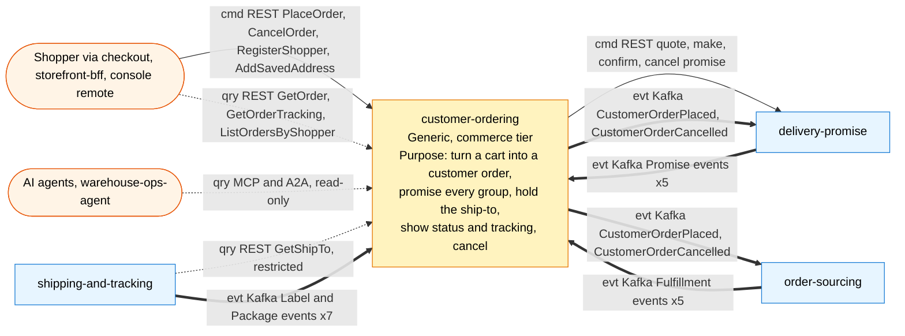

# Bounded context canvas

Following the ddd-crew [Bounded Context Canvas v5](https://github.com/ddd-crew/bounded-context-canvas),
filled in from the code and the ADRs of this repo.

## Canvas at a glance

Source: `cmd/api/main.go`, `internal/adapters/inbound/*`,
`internal/adapters/outbound/deliverypromise/gateway.go`,
`internal/adapters/outbound/kafka/encoder.go`, `apis/openapi.yaml`,
`apis/asyncapi.yaml`. Solid arrows are commands, dotted queries, thick events.

## Name

**Customer Ordering** (`customer-ordering`, CloudEvents tier `commerce`, entity
`customerorder`, Helm chart `charts/customer-ordering`).

## Purpose

To turn a shopper's cart into a customer order. The context:

- makes and confirms a promise at `delivery-promise` for every shipment group at
  checkout, quoting again when the offer the shopper saw is unusable;
- records the order with the shopper and the ship-to address (synthetic PII, held
  only here);
- publishes `CustomerOrderPlaced` with the promise snapshot of every group, so
  `order-sourcing` does not have to correlate two streams;
- shows status and tracking, built from promise, fulfilment and package events;
- handles customer cancellation while a group is unlocked, and keeps shoppers with
  their saved addresses and order history.

## Strategic classification

| Axis | Verdict |
| --- | --- |
| **Domain** | **Generic** subdomain ([Subdomain classification](/docs/ddd/subdomain-classification), [Core domain chart](/docs/ddd/core-domain-chart)) |
| **Business model** | Engagement (the storefront transaction) |
| **Evolution** | Commodity (checkout promising is Product-stage) |

## Domain roles

| Role | Applies? | Evidence |
| --- | --- | --- |
| **Execution (checkout)** | Yes, primary | `usecases.PlaceOrder`, policy `CheckoutPromising` |
| **Gateway (storefront)** | Yes | `POST /checkout`, `GET /orders/...`, `POST /orders/{orderId}:cancel`, shopper routes: the Open Host Service the storefront uses |
| Analysis | No | the tracking view is a projection for display, not a decision |
| Specification / enforcer | No | promise rules and capacity belong to `delivery-promise` |

## Inbound communication

| Collaborator | Message | Type | Channel | Relationship |
| --- | --- | --- | --- | --- |
| Shopper, storefront-bff, checkout | `PlaceOrder`, `CancelOrder`, `RegisterShopper`, `AddSavedAddress` | Command | REST `POST /checkout`, `POST /orders/{orderId}:cancel`, `POST /shoppers`, `POST /shoppers/{shopperId}/addresses` | Open Host |
| Shopper, storefront-bff | `GetOrder`, `GetOrderTracking`, `ListOrdersByShopper`, `GetShopper`, `FindShopperByEmail` | Query | REST `GET /orders/{orderId}`, `/tracking`, `GET /orders?shopperId=`, `GET /shoppers/{shopperId}`, `GET /shoppers?email=` | Open Host |
| `shipping-and-tracking` | `GetShipTo` | Query | REST `GET /orders/{orderId}/ship-to` (restricted) | Customer/Supplier (we are the Supplier) |
| AI agents, `warehouse-ops-agent` | `get_order`, `get_order_tracking`, `get_ship_to` | Query | MCP `/mcp`; A2A skills `get_order`, `get_order_tracking` | read-only |
| `delivery-promise` | `PromiseAtRisk`, `PromiseRevised`, `PromiseKept`, `PromiseBroken`, `PromiseUnkeepable` | Event | Kafka `retailnetwork.delivery-promise.events` | Customer/Supplier |
| `order-sourcing` | `FulfillmentLocked`, `FulfillmentShipped`, `FulfillmentUnsourceable`, `FulfillmentCancelled`, `FulfillmentCancelRefused` | Event | Kafka `retailnetwork.order-sourcing.events` | Conformist |
| `shipping-and-tracking` | `LabelIssued`, `LabelVoided`, `PackageScanned`, `PackageDelivered`, `PackageExceptionRaised`, `PackageLost`, `PackageReturned` | Event | Kafka `retailnetwork.shipping-and-tracking.events` | Conformist |

Full types: [Event catalogue](/docs/api-reference/events).

## Outbound communication

| Collaborator | Message | Type | Channel | Relationship |
| --- | --- | --- | --- | --- |
| `delivery-promise` | quote offers, make promise, confirm promise, cancel promise (compensation) | Command / query | REST `POST /delivery-offers:quote`, `POST /promises`, `POST /promises/{id}:confirm`, `POST /promises/{id}:cancel` | Customer/Supplier (we are the Customer) |
| `order-sourcing`, `delivery-promise` | `CustomerOrderPlaced`, `CustomerOrderCancelled` | Event | Kafka `retailnetwork.customer-ordering.events` | Customer/Supplier (we are the Supplier) |

`delivery-promise` reconciles its confirmation on `CustomerOrderPlaced` and
cancels promises on `CustomerOrderCancelled`; `order-sourcing` queues one
assignment per group and takes a cancel request per listed group.

## Ubiquitous language

Full glossary: [Ubiquitous language](/docs/ddd/ubiquitous-language). Top terms:
**Shopper**, **Customer order**, **Ship-to** (PII, held only here), **Checkout**,
**Group promise** (a snapshot of the promise), **Shipment group**, **Offer**,
**Lock** (ends customer cancellation of that group).

## Business decisions

1. **No order without a promise per group.** Every line is in exactly one group
   and every group has a promise (`ErrLineWithoutPromise`); the promise's
   destination postal prefix matches the ship-to
   (`ErrPromiseDestinationMismatch`).
2. **Promise from the offer the shopper saw.** If an offer is expired, consumed
   or cannot be confirmed, nothing is placed and fresh offers are shown
   (`CheckoutPromising`, `409 offer-not-quotable`).
3. **An order's ship-to leaves only through `GET /orders/{orderId}/ship-to`** (and
   the MCP tool `get_ship_to`); the shopper routes return the shopper's own saved
   addresses; events carry `destinationPostalPrefix` only.
4. **A cancel is a request** and only for unlocked groups
   (`ErrCancelAfterLock` when none is); order-sourcing accepts or refuses.
5. **Status moves forward only** (`ErrStatusRegression`); `LOST` and `RETURNED`
   groups are terminal.
6. **An unkeepable group is cancelled, not kept open** (`CancelOnUnfulfillable`).
7. **At most one shopper per e-mail and 20 saved addresses per shopper.**

## Assumptions

- `delivery-promise` answers within `DELIVERY_PROMISE_TIMEOUT` (default 5 s); the
  checkout has no fallback promise and answers `503 delivery-promise-unavailable`.
- The outbox relay keeps lag small enough that delivery-promise sees
  `CustomerOrderPlaced` before any hold on its side lapses; the code does not
  check this.
- order-sourcing publishes `FulfillmentLocked` for every locked group, so the
  cancel check can use local data; it is advisory (a lock not yet consumed is
  invisible here).
- "Restricted" on the ship-to route is by network placement and documentation:
  the fleet has no authentication.

## Verification metrics

| Metric | Source |
| --- | --- |
| Checkout attempts by `outcome` and `reason` | counter `ordering.orders.placed` ([Observability](/docs/operations/observability)) |
| Share of `409 offer-not-quotable` | the same counter, or the access log |
| Latency of `POST /checkout` including every promise call | `http.server.request.duration` and traces |
| Unpublished and parked rows in `outbox_events` | SQL in the [Runbook](/docs/operations/runbook#outbox-relay) |
| Dead-lettered messages | `<topic>.dlq` topics |
| Ship-to fields in any event | contract test over `apis/asyncapi.yaml` |

## Open questions

- Whether a cancel racing a lock that order-sourcing already made needs a
  compensation: today order-sourcing refuses (`FulfillmentCancelRefused`) and the
  group returns to `LOCKED`.
- How the restricted ship-to route should be protected without authentication:
  no mechanism exists and none is planned in this repo.
- When delivery-promise's hold lapses before `CustomerOrderPlaced` is consumed,
  this context is not told (it consumes no promise-released event).
