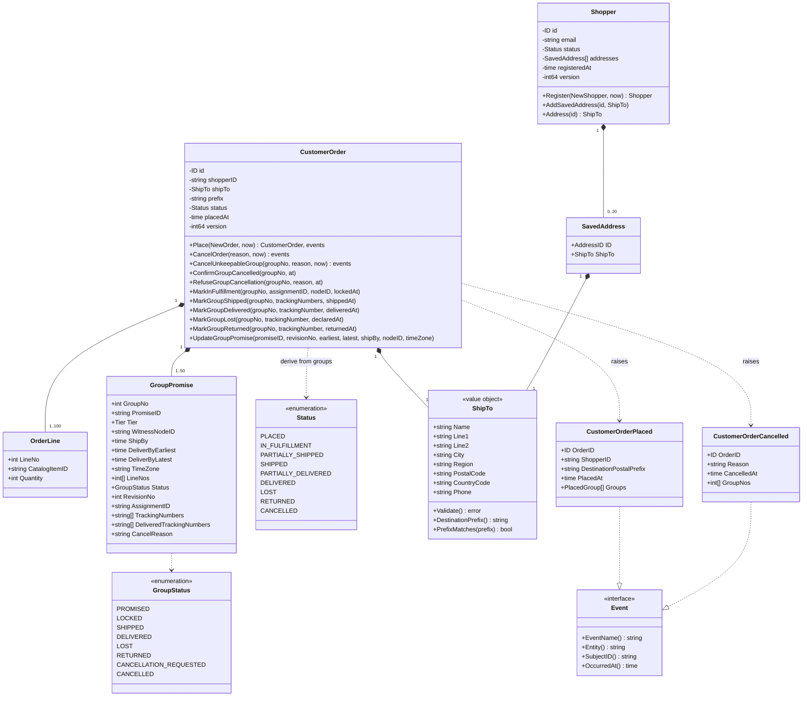

# Class diagrams

Two views: the domain types, and the hexagonal ports with the adapters that
implement them. Go has no classes; a box is a struct or interface and the
`<<interface>>` stereotype marks a Go interface.

## Domain types

Source: `internal/domain/customerorder/{order,place,cancel,commands,status,events}.go`,
`internal/domain/shopper/shopper.go`, `internal/domain/shipto/shipto.go`,
`internal/domain/shared/shared.go`. In the code `Place` is a package function
(`customerorder.Place`) and `Register` is `shopper.Register`; they are drawn on
their aggregate for readability.

## Ports and adapters

```mermaid
classDiagram
  class OrderRepository {
    <<interface>>
    +Get(id) CustomerOrder
    +Save(order)
    +ListByShopper(shopperID, afterPlacedAt, afterOrderID, limit)
  }
  class ShopperRepository {
    <<interface>>
    +Get(id) Shopper
    +FindByEmail(email) Shopper
    +Save(shopper)
  }
  class TrackingRepository {
    <<interface>>
    +LinkAssignment()
    +ApplyLabel()
    +ApplyScan()
    +ApplyDelivery()
    +ApplyOutcome()
    +PatchGroupSignal()
    +Packages(orderID)
  }
  class Inbox {
    <<interface>>
    +Claim(eventID, eventType) first
  }
  class EventOutbox {
    <<interface>>
    +Append(events)
  }
  class UnitOfWork {
    <<interface>>
    +Do(fn)
  }
  class PromiseGateway {
    <<interface>>
    +QuoteOffers()
    +MakePromise()
    +ConfirmPromise()
    +CancelPromise()
  }
  class IdempotencyStore {
    <<interface>>
    +Get(route, key)
    +Put(route, key, record)
  }
  class OrderMetrics {
    <<interface>>
    +OrderPlaced()
    +OrderRejected(reason)
  }
  class PlaceOrder
  class CancelOrder
  class Consumer
  class GetOrder
  class PostgresAdapters {
    OrderRepository
    ShopperRepository
    TrackingRepository
    Inbox
    OutboxRepo
    UnitOfWork
    IdempotencyStore
  }
  class DeliveryPromiseGateway {
    HTTP client, 5s timeout
  }
  class OrderMetricsAdapter {
    ordering.orders.placed
  }
  class HttpServer {
    chi router, /checkout, /orders, /shoppers
  }
  class KafkaConsumers {
    delivery-promise, order-sourcing, shipping-and-tracking
  }
  class McpServer {
    get_order, get_order_tracking, get_ship_to
  }
  class A2aServer {
    skills get_order, get_order_tracking
  }
  class OutboxRelay {
    publishes outbox_events
  }
  HttpServer --> PlaceOrder
  HttpServer --> CancelOrder
  HttpServer --> GetOrder
  KafkaConsumers --> Consumer
  McpServer --> GetOrder
  A2aServer --> GetOrder
  PlaceOrder ..> OrderRepository
  PlaceOrder ..> PromiseGateway
  PlaceOrder ..> UnitOfWork
  PlaceOrder ..> EventOutbox
  PlaceOrder ..> OrderMetrics
  Consumer ..> Inbox
  Consumer ..> TrackingRepository
  Consumer ..> OrderRepository
  GetOrder ..> OrderRepository
  PostgresAdapters ..|> OrderRepository
  PostgresAdapters ..|> ShopperRepository
  PostgresAdapters ..|> TrackingRepository
  PostgresAdapters ..|> Inbox
  PostgresAdapters ..|> EventOutbox
  PostgresAdapters ..|> UnitOfWork
  PostgresAdapters ..|> IdempotencyStore
  DeliveryPromiseGateway ..|> PromiseGateway
  OrderMetricsAdapter ..|> OrderMetrics
  OutboxRelay --> PostgresAdapters
```

Source: `internal/application/ports/ports.go`,
`internal/application/usecases/*.go`, `internal/adapters/inbound/*`,
`internal/adapters/outbound/*`, wiring in `cmd/api/main.go`. `cmd/mcp` and
`cmd/a2a` wire only the read use cases; `outbound/memory` and `repocontract`
(an in-memory double and its shared contract test) are used by tests only and no
`cmd/` binary imports them.
