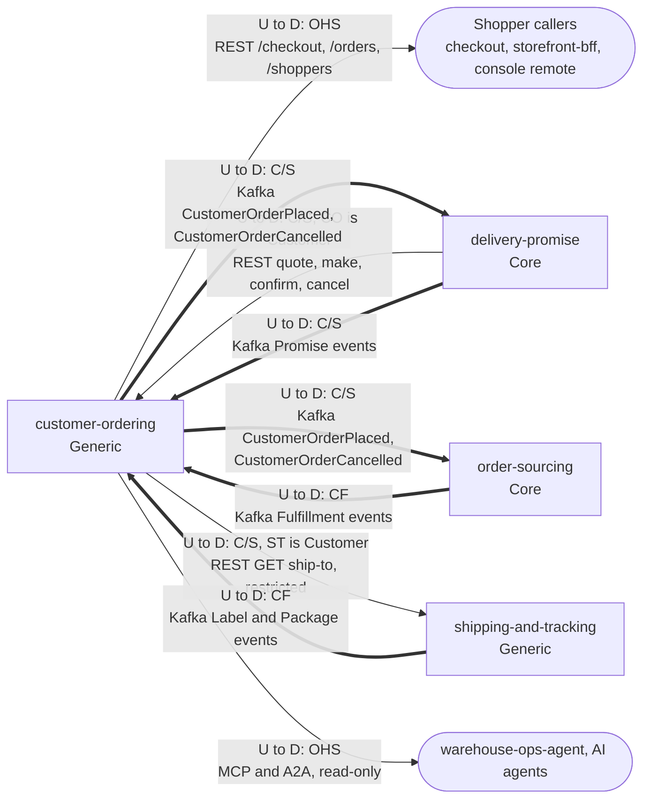

# Context map

Following ddd-crew [Context Mapping](https://github.com/ddd-crew/context-mapping).
This is `customer-ordering`'s slice of the map: every relationship the code
builds, with upstream (U) and downstream (D) side, the pattern and the channel.
The network-wide map is in the aggregator at
[Context Map](https://iqvo.github.io/warehouse-docs/network/strategic-design/context-map).
Edge status (which side has code) is on [Integration](/docs/ecosystem/integration).

Source: `internal/adapters/outbound/deliverypromise/gateway.go`,
`internal/adapters/inbound/kafka/handlers.go`, `apis/asyncapi.yaml`,
`apis/openapi.yaml`, `internal/adapters/inbound/mcp`, and the sibling files read
for [Integration](/docs/ecosystem/integration). Arrows point from upstream to
downstream; solid is synchronous, thick is Kafka. `delivery-promise` appears in
both directions: upstream for the checkout calls and the promise events,
downstream for the order events.

## Relationships

| Neighbour | Direction | Pattern | Channel | Messages | Why this pattern |
| --- | --- | --- | --- | --- | --- |
| Shopper callers (`checkout`, `storefront-bff`, console remote) | CO upstream | **Open Host Service** | REST `POST /checkout`, `GET /orders...`, `POST /orders/{orderId}/cancellations`, `/shoppers...` | `PlaceOrder`, `GetOrder`, `GetOrderTracking`, `CancelOrder`, shopper commands and queries | Many clients use one published, versioned API (`apis/openapi.yaml`); none negotiates it. |
| `delivery-promise` | DP upstream, CO downstream | **Customer/Supplier** (CO is the Customer) | REST, `DELIVERY_PROMISE_URL` | quote, make, confirm, cancel promise | Checkout needs an answer inside the shopper's request; DP serves this caller deliberately. |
| `delivery-promise` | CO upstream, DP downstream | **Customer/Supplier** | Kafka `retailnetwork.customer-ordering.events` | `CustomerOrderPlaced`, `CustomerOrderCancelled` | DP reconciles the confirmation on placement and releases the hold on cancellation. |
| `delivery-promise` | DP upstream, CO downstream | **Customer/Supplier** | Kafka `retailnetwork.delivery-promise.events` | `PromiseAtRisk`, `PromiseRevised`, `PromiseKept`, `PromiseBroken`, `PromiseUnkeepable` | CO keeps each group's window current and acts on `PromiseUnkeepable`. |
| `order-sourcing` | CO upstream, OS downstream | **Customer/Supplier** | Kafka `retailnetwork.customer-ordering.events` | `CustomerOrderPlaced`, `CustomerOrderCancelled` | OS queues one assignment per group from the placement; the event carries each group's promise snapshot (negotiated payload). |
| `order-sourcing` | OS upstream, CO downstream | **Conformist** | Kafka `retailnetwork.order-sourcing.events` | `FulfillmentLocked`, `FulfillmentShipped`, `FulfillmentUnsourceable`, `FulfillmentCancelled`, `FulfillmentCancelRefused` | CO takes the assignment facts as published and projects them into status. |
| `shipping-and-tracking` | CO upstream, ST downstream | **Customer/Supplier** (ST is the Customer) | REST `GET /orders/{orderId}/ship-to` (restricted) | `GetShipTo` | The one sanctioned read of PII outside this context, a dedicated route built for one customer. |
| `shipping-and-tracking` | ST upstream, CO downstream | **Conformist** | Kafka `retailnetwork.shipping-and-tracking.events` | `LabelIssued`, `LabelVoided`, `PackageScanned`, `PackageDelivered`, `PackageExceptionRaised`, `PackageLost`, `PackageReturned` | Package facts are taken as published, for status and tracking. |
| `warehouse-ops-agent`, AI agents | CO upstream | **Open Host Service** (read-only) | MCP Streamable HTTP, A2A JSON-RPC | `get_order`, `get_order_tracking`, `get_ship_to` | Agents read the same use cases as REST; no write tool exists. |

## Notes on the patterns

- **No Anti-Corruption Layer.** Every upstream is inside the same network and
  speaks its language; consumers read events as published (tolerant reader:
  unknown fields are ignored). The ACLs that exist are on the caller side
  (`checkout`'s customer-ordering adapter).
- **No Shared Kernel.** `promiseId`, `assignmentId` and `trackingNumber` are
  values copied from events, not shared code; `deliverypromise/gateway.go`
  restates the four routes it uses with its own DTOs.
- **No fleet edge.** This context never consumes a `warehouse.*` topic and never
  calls a WMS or WES service.
- **Separate Ways** with `node-topology`, `offer-availability`,
  `vendor-connectivity`, `linehaul-transportation`, `last-mile-delivery`,
  `node-performance` and `seller-inbound`: no edge in the code. The tracking
  view is event-fed; this context never calls shipping-and-tracking's journey
  route.
- **Other storefront contexts** (`pricing`, `shopping-cart`, `customer-payments`,
  ...) have no edge with this one. The callers found in code are `checkout` and
  `storefront-bff`, both over REST.
