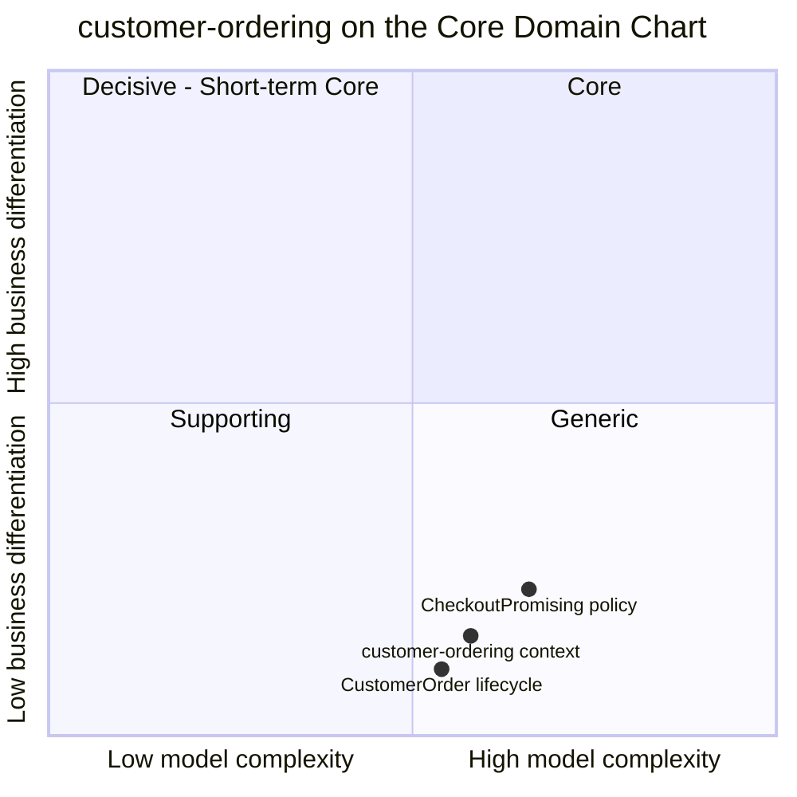

# Core domain chart

Following the ddd-crew [Core Domain Charts](https://github.com/ddd-crew/core-domain-charts):
business differentiation (y) against model complexity (x). The network-wide chart
is in the aggregator at
[Core Domain Chart](https://iqvo.github.io/warehouse-docs/network/strategic-design/core-domain-chart).

Source: the context's point (`complexity` 0.58, `differentiation` 0.15) is the
aggregator model's (`network/model/model.yaml` in warehouse-docs); the two slices
are placed by judgement from `internal/application/usecases/checkout.go` and
`internal/domain/customerorder/`. The `Shopper` aggregate is omitted: it is a
one-state registry and would only show that an account registry is simple.

## Classification: Generic

All three points sit in **quadrant 4 (Generic)**. Every online shop has a
checkout and an order record, and no shopper chooses this network because of how
its order record works. They choose it for the date on the order, and that date
is owned by `delivery-promise` (Core).

**Differentiation is low.** The context makes no delivery decision. It never
computes a date, never holds capacity and never chooses a node. Its rules are
ordinary storefront rules: each line in one group, each group promised, the
address kept private, cancellation until the work is committed.

**Complexity is moderate.** It is not trivial, for reasons visible in the code:

- Checkout is a **synchronous multi-call** to `delivery-promise` (make and confirm
  a promise per group, quote again when an offer expired) with a compensating
  cancel of promises already confirmed when a later confirm fails.
- The aggregate derives its status from **eight group states**, driven by three
  upstream streams (`delivery-promise`, `order-sourcing`, `shipping-and-tracking`)
  that arrive in no guaranteed order across topics, and `LOST` and `RETURNED` are
  terminal.
- It is the **PII boundary** of the network: one restricted read path
  (`GET /orders/{orderId}/ship-to`) and no address in any event.
- `CustomerOrderPlaced` carries a **per-group promise snapshot**, so
  `order-sourcing` never correlates two streams.

The **CheckoutPromising** slice is plotted highest and furthest right because it
is where the context meets the Core promise. It still makes no decision of its
own, so it stays Generic.

## Business model

**Engagement (the storefront transaction).** The context earns nothing by itself:
it is the moment the shopper commits. Its value is the conversion it does not
lose, for example checkouts that fail because an offer expired (the
`ordering.orders.placed` counter, labelled by `outcome` and `reason`, measures
exactly that; see [Observability](/docs/operations/observability)).

## Evolution

| Part | Evolution stage | Why |
| --- | --- | --- |
| Order record, status, cancellation | **Commodity** | Standard e-commerce order management; a bought order-management product would fit. |
| Checkout promising (per-group make and confirm) | **Product** | An order service calling a promise service is a common shape; the per-group promise snapshot in `CustomerOrderPlaced` is specific to this network's split between promise and assignment. |
| Ship-to confinement and the restricted route | **Commodity** practice, local rule | PII minimisation is standard; the one-reader rule is this network's. |
| Plumbing (outbox, inbox, CloudEvents) | **Commodity** | Building blocks shared across the fleet. |

**Movement to watch.** Nothing moves this context up. If the network bought a
commercial order-management product, this context would shrink to an adapter
around it, the expected path for a Generic subdomain. The surface to keep stable
would be `POST /checkout`, the two published events and the ship-to route. See
[Subdomain classification](/docs/ddd/subdomain-classification).
