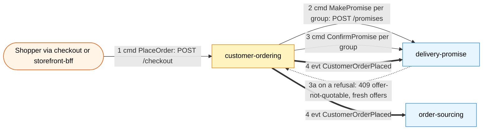
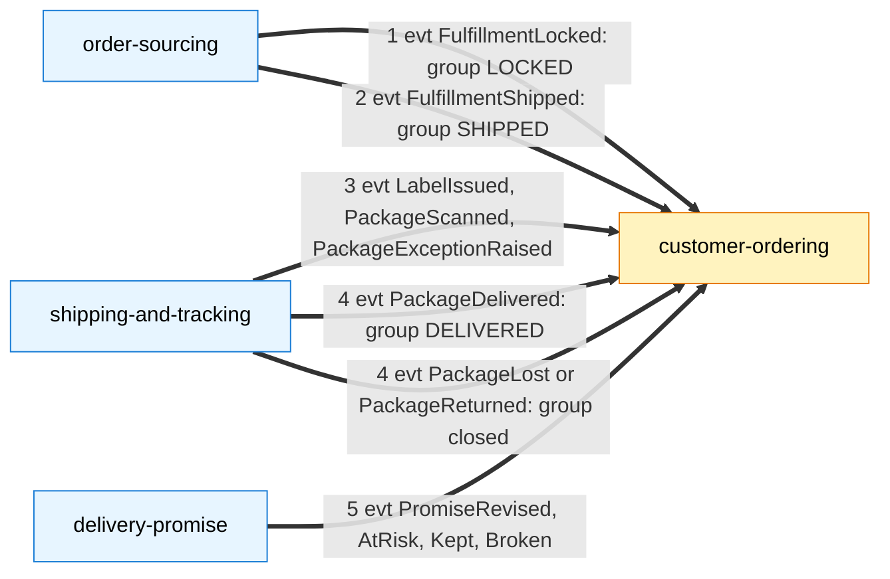
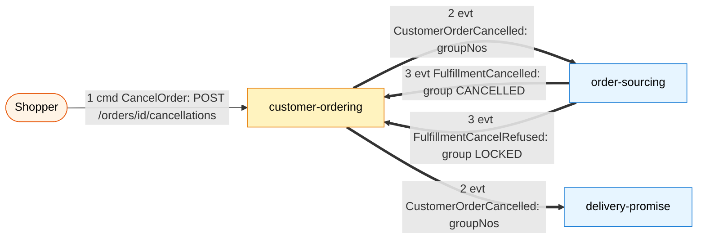
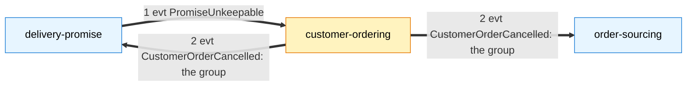
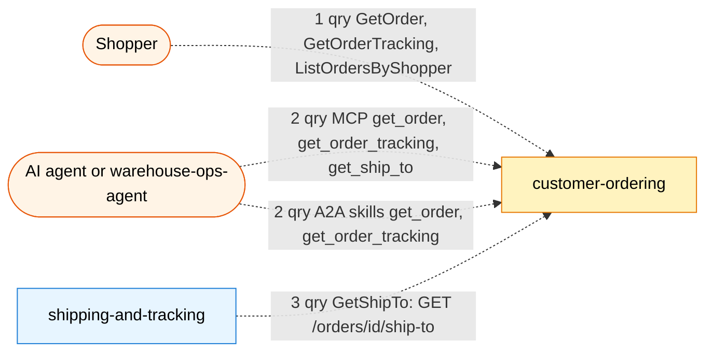

# Domain message flow

Following ddd-crew [Domain Message Flow Modelling](https://github.com/ddd-crew/domain-message-flow-modelling):
the key scenarios as numbered commands (`cmd`), queries (`qry`) and events (`evt`)
between the context and its collaborators. The same scenarios as timed sequences,
with error branches, are on [Sequence diagrams](/docs/ddd/sequence-diagrams).

## Flow 1: a shopper places an order

`2` and `3` are separated on purpose: every promise is made and the order checked
against them before any is confirmed. On a failed confirm the promises already
confirmed are cancelled (`POST /promises/{id}/cancellations`). Source:
`internal/application/usecases/checkout.go`.

## Flow 2: the order moves through fulfilment

Each arrow is applied in one transaction with the claim of the CloudEvents id.
The order status is derived from the group states after every change. Source:
`internal/application/usecases/consume_*.go`.

## Flow 3: the shopper cancels

Source: `internal/application/usecases/cancel.go`, `consume_sourcing.go`.

## Flow 4: an unkeepable promise

Policy `CancelOnUnfulfillable`: the `PROMISED` group becomes `CANCELLED` at once.
Source: `internal/application/usecases/consume_promise.go`.

## Flow 5: reads

Every read returns from Postgres through the same read use cases; only
`GetShipTo` returns the address. Source: `internal/application/usecases/queries.go`,
`internal/adapters/inbound/{http,mcp,a2a}`.
