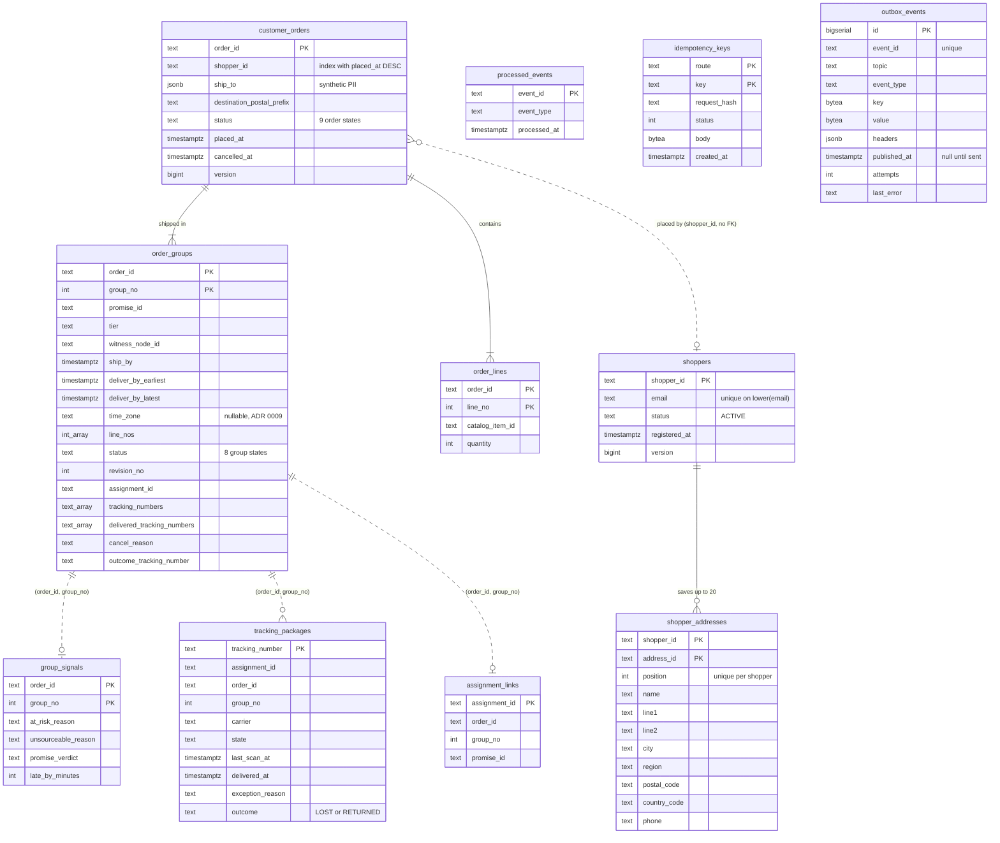

# Entity-relationship diagram

The Postgres schema as the embedded migrations create it
(`internal/adapters/outbound/postgres/migrations/0001` to `0004`, applied at boot
by golang-migrate). Eleven tables of the context plus golang-migrate's own
`schema_migrations`. Foreign keys exist only where the diagram draws a
relationship; the tracking read model and the infrastructure tables are keyed by
ids copied from events and carry no foreign key.

Source: `internal/adapters/outbound/postgres/migrations/0001_customer_ordering_schema.up.sql`,
`0002_package_lost_and_returned.up.sql`, `0003_shopper_addresses_and_order_history.up.sql`,
`0004_group_window_time_zone.up.sql`. Columns not drawn: `order_groups` also holds
`node_id`, `locked_at`, `shipped_at`, `delivered_at`, `cancel_requested_at`,
`cancelled_at`, `cancel_refused_reason`, `lost_at`, `returned_at`;
`tracking_packages` also holds `last_scan_node_id`, `outcome_at`; `outbox_events`
also holds `subject`, `dataschema`, `created_at`.

## Reading it

- **Aggregates.** `customer_orders`, `order_lines` and `order_groups` are the
  `CustomerOrder` aggregate, saved together under the optimistic rule "stored
  `version` equals the version loaded". `shoppers` and `shopper_addresses` are
  the `Shopper` aggregate; `shopper_addresses` replaced the old JSON column in
  migration 0003 (legacy addresses got ids `legacy-<md5>`).
- **PII.** `customer_orders.ship_to` and `shopper_addresses` are the only
  places an address is stored. The order list index
  `customer_orders_history_idx (shopper_id, placed_at DESC, order_id)` serves
  `GET /orders?shopperId=` keyset paging.
- **Read model.** `group_signals`, `tracking_packages` and `assignment_links` are
  event-fed upserts that tolerate any arrival order; they are joined with the
  order's groups by `GET /orders/{orderId}/tracking`.
- **Infrastructure.** `processed_events` (inbox) is written in the same
  transaction as the effect it guards. `idempotency_keys` holds a POST answer
  for 24 hours. `outbox_events` has a partial index on rows not yet published;
  the relay claims them, and rows past `OUTBOX_MAX_ATTEMPTS` failures are
  excluded from claims (see the [Runbook](/docs/operations/runbook#outbox-relay)).
- **Down migrations** exist for all four steps; there is no cross-service
  database access (`MIGRATIONS_DATABASE_URL` is the direct DSN, `DATABASE_URL`
  goes through PgBouncer).
