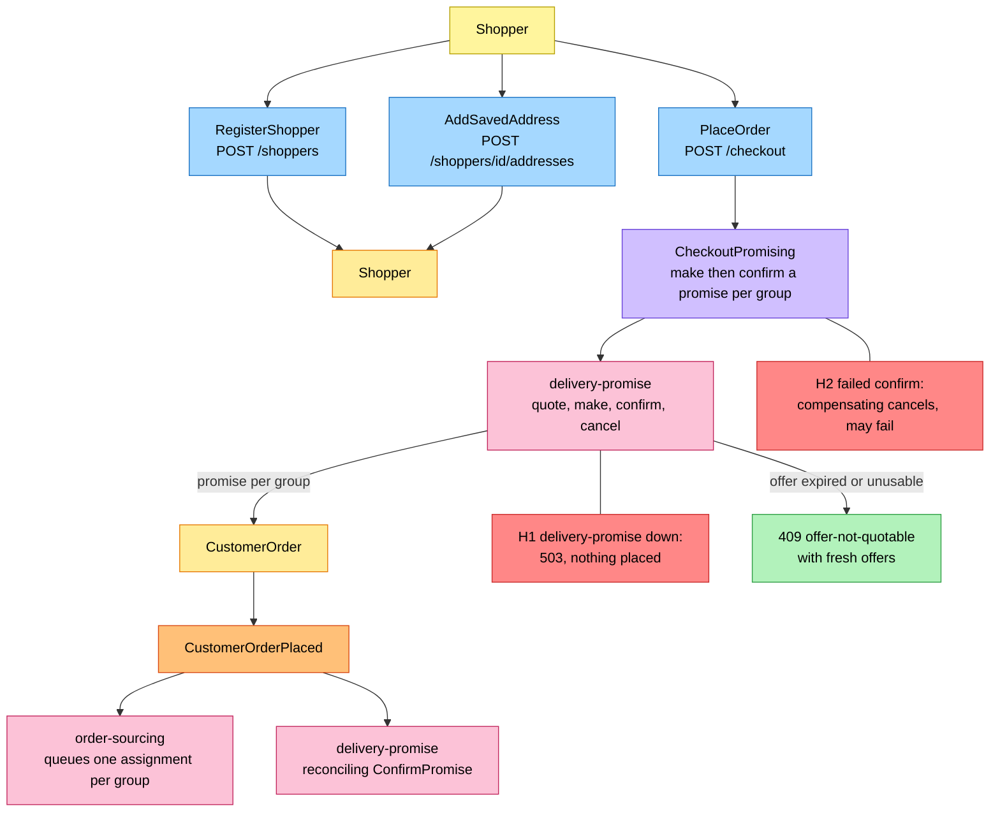
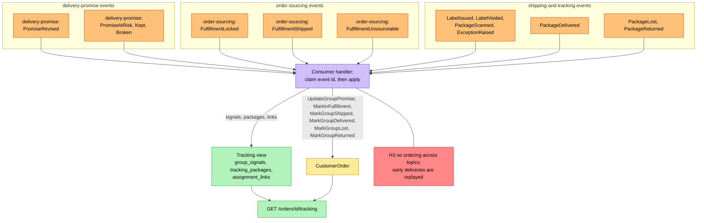
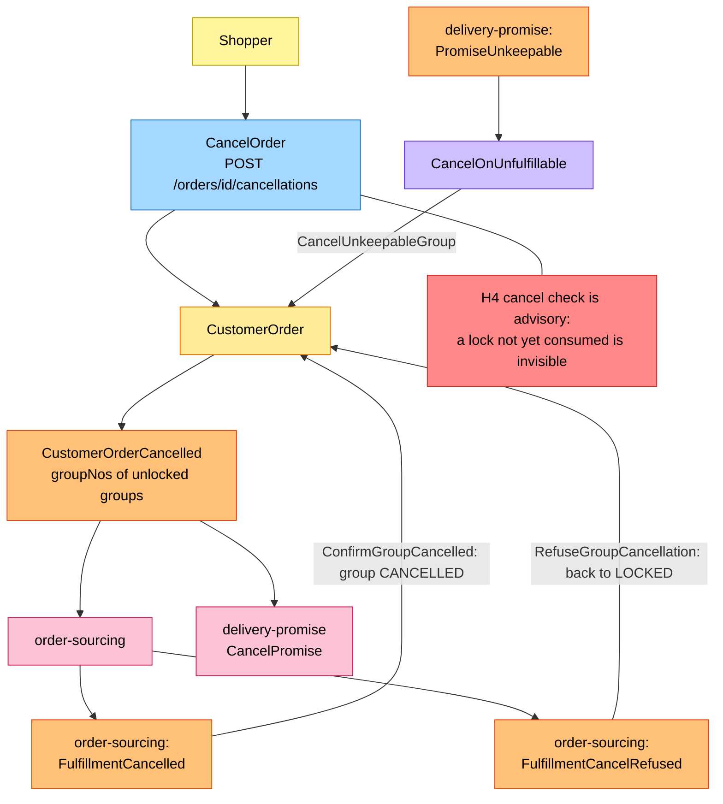

# EventStorming

Design-level boards in the ddd-crew
[EventStorming glossary and cheat sheet](https://github.com/ddd-crew/eventstorming-glossary-cheat-sheet)
notation, drawn from the code on `develop`. Events of a neighbour are orange
stickies prefixed with the producer. Every hotspot is a gap or risk visible in
the code or the contracts; the table at the end names its source. The big picture
for the whole network is in the aggregator at
[EventStorming big picture](https://iqvo.github.io/warehouse-docs/network/strategic-design/eventstorming-big-picture).

## Legend

| Colour | Sticky | Meaning here |
| --- | --- | --- |
| Pale yellow `#fff59d` | Actor | The shopper, through `checkout`, `storefront-bff`, the console remote or a test |
| Blue `#a5d8ff` | Command | A use case or a synchronous call to delivery-promise |
| Yellow `#ffec99` | Aggregate | `CustomerOrder` or `Shopper` |
| Orange `#ffc078` | Domain event | Ours, or a neighbour's prefixed with its producer |
| Lilac `#d0bfff` | Policy | `CheckoutPromising`, `CancelOnUnfulfillable`, or the reaction of a handler to an event |
| Green `#b2f2bb` | Read model | The tracking view, or the restricted ship-to read |
| Pink `#fcc2d7` | External system | A sibling context |
| Red `#ff8787` | Hotspot | A gap or risk (table at the end) |

## 1. Registration and checkout

Source: `internal/application/usecases/checkout.go`, `shopper.go`,
`internal/domain/customerorder/place.go`,
`internal/adapters/outbound/deliverypromise/gateway.go`.

## 2. Fulfilment progress and tracking

Source: `internal/adapters/inbound/kafka/handlers.go`,
`internal/application/usecases/consume_promise.go`, `consume_sourcing.go`,
`consume_tracking.go`, `internal/domain/customerorder/commands.go`.

## 3. Cancellation

Source: `internal/application/usecases/cancel.go`,
`internal/domain/customerorder/cancel.go`, `consume_promise.go`,
`consume_sourcing.go`.

## Reading it

- The shopper's cancel is a **request**: the group stays in
  `CANCELLATION_REQUESTED` until order-sourcing answers, and a vendor that ships
  first wins.
- `Shopper` raises no event and `GetShipTo` is a read, so neither appears as an
  orange sticky.
- The synchronous replies and the outbox are omitted from the boards.

## Hotspots

| # | Hotspot | Source |
| --- | --- | --- |
| H1 | If delivery-promise is slow or down the checkout answers `503 delivery-promise-unavailable` after `DELIVERY_PROMISE_TIMEOUT`; there is no fallback promise and the caller must retry with the same `Idempotency-Key`. | `deliverypromise/gateway.go`, `http/errors.go` |
| H2 | A confirm that fails after earlier groups were confirmed triggers compensating `CancelPromise` calls; one that fails is only logged (`compensating cancel of a confirmed promise failed; the hold stays at delivery-promise`) and skipped, so a capacity hold can outlive a failed checkout. When the failed confirm's own answer is unknown its group is cancelled too. | `usecases/checkout.go` (`compensate`), ADR 0002 A14 |
| H3 | Producers key by their own ids, so a delivery or outcome can arrive before `FulfillmentShipped`; the code stores and replays it, an unknown order is skipped, not retried. | `consume_tracking.go`, ADR 0002 A7 |
| H4 | `ErrCancelAfterLock` is advisory: a lock this service has not consumed yet cannot be seen, and order-sourcing's answer decides. | `customerorder/cancel.go` |
| H5 | If publishing to a `.dlq` topic fails, the consumer keeps retrying and the partition is blocked. | [Runbook](/docs/operations/runbook#consumers-and-the-dlq) |
| H6 | `apis/asyncapi.yaml` says the service consumes "Fifteen events" but lists seventeen. | `apis/asyncapi.yaml` info description |
