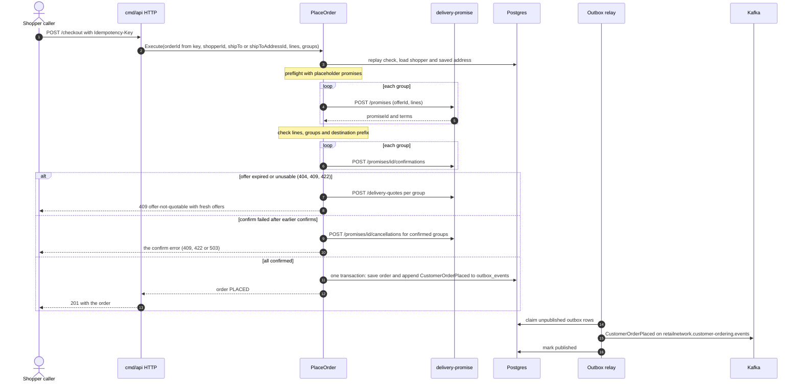
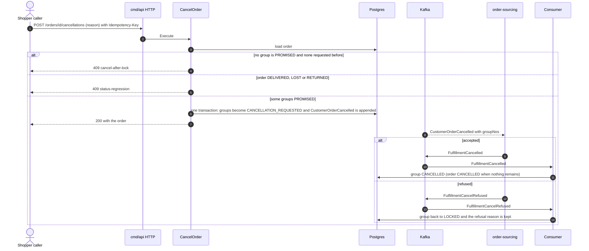
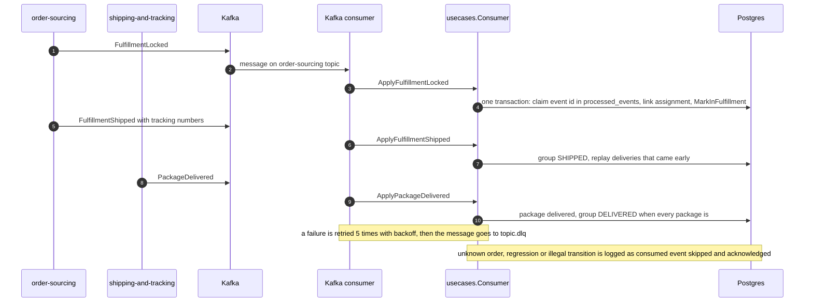
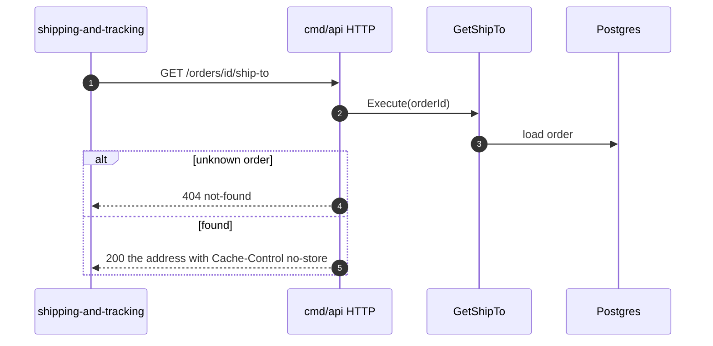
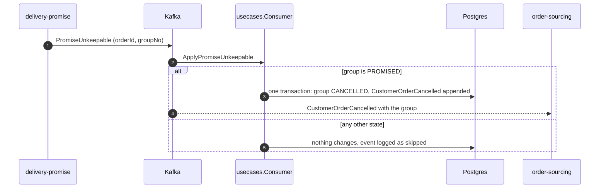

# Sequence diagrams

The key scenarios with their error branches, drawn from the code on `develop`.
Every diagram has a `Source:` line.

## Place an order

Source: `internal/application/usecases/checkout.go`,
`internal/adapters/outbound/deliverypromise/gateway.go`,
`internal/adapters/outbound/outbox/relay.go`,
`internal/adapters/inbound/http/handlers.go`. A timeout or 5xx from
delivery-promise is `503 delivery-promise-unavailable`; a replay of the same
`Idempotency-Key` returns the stored answer.

## Cancel an order

Source: `internal/application/usecases/cancel.go`,
`internal/domain/customerorder/cancel.go`,
`internal/application/usecases/consume_sourcing.go`. A repeat cancel changes and
publishes nothing.

## A consumed event moves the order forward

Source: `internal/adapters/inbound/kafka/consumer.go`, `deadletter.go`,
`internal/application/usecases/consume_sourcing.go`, `consume_tracking.go`,
`deps.go`.

## Read the ship-to for a label

Source: `internal/application/usecases/queries.go`,
`internal/adapters/inbound/http/handlers.go`. If this call fails,
shipping-and-tracking refuses the label (`ship-to-unavailable` on its side); the
same read is available to agents as the MCP tool `get_ship_to`.

## Unkeepable promise

Source: `internal/application/usecases/consume_promise.go`,
`internal/domain/customerorder/cancel.go` (`CancelUnkeepableGroup`).
