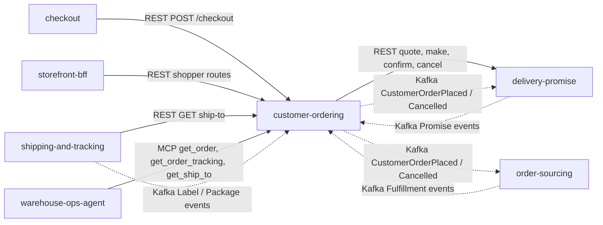

# Integration

How `customer-ordering` fits with the rest of the fleet, with the **status of
every edge**. Producer and caller sides were read on each sibling's
`origin/develop` on 2026-10-31 (`delivery-promise`, `order-sourcing`,
`shipping-and-tracking`, `checkout`, `storefront-bff`, `warehouse-ops-agent`,
`warehouse-infra`); the words are used strictly:

- **Built**: code on this repo's `develop` that does the job.
- **Verified**: the other side has code that matches.
- **Absent**: no code on either side.

This context makes exactly **one** outbound call to another service,
`delivery-promise`, and consumes the Kafka topics of three siblings. It never
calls `order-sourcing` or `shipping-and-tracking`, and `cmd/mcp` and `cmd/a2a`
call nobody (`TestMCPServerIsReadOnly`,
`TestA2AServerIsReadOnlyAndHasNoOutboundClient`).

## Edge map

Source: `internal/adapters/outbound/deliverypromise/gateway.go`,
`internal/adapters/inbound/kafka/handlers.go`,
`internal/adapters/outbound/kafka/encoder.go`, `apis/asyncapi.yaml`,
`apis/openapi.yaml` and the sibling files named in the tables. Solid arrows are
synchronous; dotted arrows are Kafka.

## Upstream: what customer-ordering calls

| Producer | Protocol | Contract | Failure behaviour | Status |
| --- | --- | --- | --- | --- |
| delivery-promise | REST, base URL `DELIVERY_PROMISE_URL` (required), timeout `DELIVERY_PROMISE_TIMEOUT` (default 5s), response read capped at 1 MiB | `POST /delivery-quotes` (a fresh UUID `Idempotency-Key` per call); `POST /promises` (`Idempotency-Key` `<orderId>:<groupNo>`); `POST /promises/{id}/confirmations` (key `<orderId>:<groupNo>:confirm`); `POST /promises/{id}/cancellations` (key `<orderId>:<groupNo>:cancel`, the compensation) | 404/409/422 are typed refusals (`offer-not-quotable`, `promise-capacity-exhausted`, `book-closed`, `group-spans-nodes`); a timeout, transport error, 5xx or undecodable answer is `delivery-promise-unavailable` (503, retry with the same `Idempotency-Key`). Nothing is stored and a confirmed group is cancelled again. | **Built + verified** (the producer's `consumes`/REST routes name this caller) |
| delivery-promise | Kafka, CloudEvents 1.0, `retailnetwork.delivery-promise.events`, group `DELIVERY_PROMISE_CONSUMER_GROUP` | `PromiseAtRisk`, `PromiseRevised`, `PromiseKept`, `PromiseBroken`, `PromiseUnkeepable` | see *How every consumed message is handled* | **Built + verified** |
| order-sourcing | Kafka, `retailnetwork.order-sourcing.events`, group `ORDER_SOURCING_CONSUMER_GROUP` | `FulfillmentLocked`, `FulfillmentShipped`, `FulfillmentUnsourceable`, `FulfillmentCancelled`, `FulfillmentCancelRefused` | same | **Built + verified** |
| shipping-and-tracking | Kafka, `retailnetwork.shipping-and-tracking.events`, group `SHIPPING_CONSUMER_GROUP` | `LabelIssued`, `LabelVoided`, `PackageScanned`, `PackageDelivered`, `PackageExceptionRaised`, `PackageLost`, `PackageReturned` | same | **Built + verified** |

Full types and effects are on the [Event catalogue](/docs/api-reference/events).
Every `type` is dispatched in full; the three group ids have no default and a
missing one is a boot error.

### How every consumed message is handled

(`internal/adapters/inbound/kafka`, `internal/application/usecases/consume_*.go`)

- The CloudEvents `id` is claimed in `processed_events` in the **same
  transaction** as the effect; the Kafka offset is committed afterwards. A
  replayed id changes nothing.
- A message that is not a valid CloudEvent is logged at WARN and committed past.
- A handling failure is retried with capped backoff (200 ms to 5 s), 5 attempts,
  then the message is published to `<topic>.dlq` with `x-dlq-*` headers. A payload
  that can never be applied (undecodable) is dead-lettered at once. Shutdown
  never dead-letters.
- An unknown order or group, a status regression and an illegal transition are
  logged as `consumed event skipped` and acknowledged (ADR 0002, A7). A
  delivery or outcome that arrives before the shipment is known is stored and
  replayed when `FulfillmentShipped` arrives.
- The readers dial lazily, so a broker outage never blocks boot; if a consumer
  or the relay returns on its own the process exits non-zero and is restarted
  ([Runbook](/docs/operations/runbook#consumers-and-the-dlq)).

## Downstream: who uses customer-ordering

| Consumer | Protocol | Contract | Status |
| --- | --- | --- | --- |
| order-sourcing | Kafka, `retailnetwork.customer-ordering.events`, its group `order-sourcing-customer-ordering` | `CustomerOrderPlaced` (one assignment per group), `CustomerOrderCancelled` (cancel request per listed group) | **Built + verified** in its `apis/asyncapi.yaml` and `internal/adapters/inbound/kafka/handlers.go` |
| delivery-promise | Kafka, same topic | `CustomerOrderPlaced` is a reconciling `ConfirmPromise` (a repeated confirm is a no-op); `CustomerOrderCancelled` cancels the promises of the named groups | **Built + verified** (`internal/adapters/inbound/kafka/dispatch.go`, `OnCustomerOrderPlaced`, `OnCustomerOrderCancelled`) |
| checkout | REST (`CUSTOMER_ORDERING_URL`) | `POST /checkout` through its customer-ordering anti-corruption adapter | **Built + verified** on the caller side |
| storefront-bff | REST (`CUSTOMER_ORDERING_URL`) | the shopper routes only; a fitness test (`bff_no_inorg_route_fitness_test.go`) forbids the in-org ship-to route | **Built + verified** on the caller side |
| shipping-and-tracking | REST (`CUSTOMER_ORDERING_URL`, required there) | `GET /orders/{orderId}/ship-to` before it issues a label; if this context is unreachable the label is refused with `ship-to-unavailable` | **Built + verified** on the caller side |
| warehouse-ops-agent | MCP over HTTP (`CUSTOMER_ORDERING_MCP_ENDPOINT`, `http://customer-ordering-mcp:8090/mcp` in the cluster) | `get_order`, `get_order_tracking`, `get_ship_to`; its client is pinned against `internal/adapters/inbound/mcp/testdata/tool_registry.golden.json` | **Built + verified** on the caller side |
| agents | A2A at `/api/a2a/customer-ordering` | skills `get_order`, `get_order_tracking` | **Built**; no known fleet client |

Publication is through the transactional outbox: the order row and its
already-encoded events are written in one transaction and the always-on relay
drains them to Kafka at least once, repeating the stored CloudEvents `id`,
capped by `OUTBOX_MAX_ATTEMPTS`
([Runbook](/docs/operations/runbook#outbox-relay)).

## Infrastructure wiring

`warehouse-infra` (`origin/develop`) installs the chart with
`helm-values/customer-ordering.yaml`: consumer groups
`customer-ordering-delivery-promise`, `customer-ordering-order-sourcing` and
`customer-ordering-shipping`; `deliveryPromiseUrl` pointing at the
`delivery-promise` Service; Kong routes `/api/customer-ordering`,
`/api/mcp/customer-ordering` and `/api/a2a/customer-ordering`; the `mcp`, `a2a`
and `frontend` components enabled. Topics are auto-created by the first writer;
a consumed topic whose producer has not written yet shows as consumer retry
logs, not as unreadiness.

## Absent edges (on purpose)

- **No call to `order-sourcing` or `shipping-and-tracking`.** Their facts arrive
  as events only; the tracking view is event-fed and this context never calls
  `GET /journeys/{trackingNumber}` of shipping-and-tracking.
- **No `warehouse.*` topic and no warehouse-systems service** (WMS/WES) is
  consumed or called.
- **No payments, notification or returns edge**: those contexts are not built
  here.
- **MCP and A2A are inbound and read-only**: they wire read use cases only, own
  no Kafka adapter and no outbound client.
- **The web remote** (`web/`, `customer_ordering_mfe`) calls only this
  context's own `/api/customer-ordering`.

## Failure behaviour

| Situation | Behaviour |
| --- | --- |
| delivery-promise down or slow at checkout | `503 delivery-promise-unavailable`, no order stored, promises of the same checkout already confirmed are cancelled; retry with the same `Idempotency-Key`. |
| Offer expired or consumed | `409 offer-not-quotable` with fresh offers; nothing placed. |
| Postgres down at boot | Retried with backoff (`bootretry`), then the process exits 1. |
| Postgres down at runtime | REST answers 500 `internal-error`; consumers fail transiently, retry and dead-letter; `/readyz` is 503. `cmd/mcp` and `cmd/a2a` fail their reads. |
| Kafka down | REST writes still commit (events wait in `outbox_events`); `/readyz` is 503; the relay retries every `OUTBOX_RELAY_INTERVAL`; consumers block on the reader and resume. |
| Duplicate or replayed event | Dropped by the inbox, no effect. |
| Poison message | Dead-lettered, the partition moves on. |
| Sibling producer not yet running | Consumer retry logs; the order stays in its last known status. |
