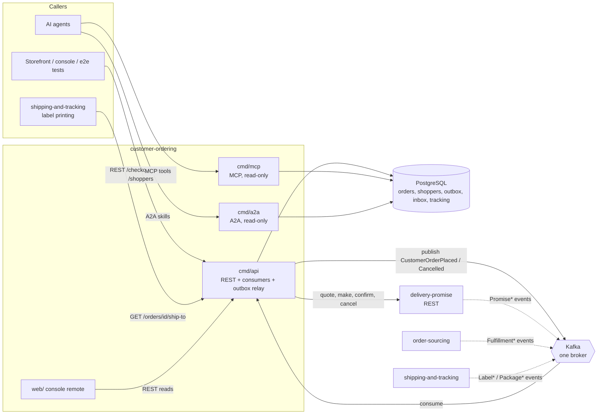

# Architecture

`customer-ordering` is hexagonal (ports and adapters). Dependencies point
inward only, and the rule is an executable test
(`internal/architecture/architecture_test.go`, `TestHexagonalArchitecture`),
not a convention.

## Layout

```text
cmd/api/                       composition root of the REST service: HTTP, three Kafka consumers, the outbox relay
cmd/mcp/                       composition root of the read-only MCP server (Streamable HTTP)
cmd/a2a/                       composition root of the read-only A2A agent (JSON-RPC, Agent Card)
internal/
  domain/                      pure Go, no I/O
    shared/                    Event, Header, validation errors, ID rules
    shipto/                    the ShipTo value object (synthetic PII)
    shopper/                   Shopper aggregate, saved addresses
    customerorder/             CustomerOrder aggregate, status derivation, events
  application/
    ports/                     the interfaces the use cases need (repositories, UnitOfWork, PromiseGateway, Clock, IDs, OrderMetrics)
    usecases/                  PlaceOrder, CancelOrder, queries, shopper use cases, the Consumer (event handlers)
    views/                     read DTOs returned by use cases
    readmodel/                 tracking read-model types (signals, packages, links)
    promising/                 the delivery-promise request and terms types
    outbox/, idempotency/      outbox message and idempotency record types
  adapters/
    inbound/http/              chi router, handlers, RFC 9457 problems, Idempotency-Key middleware, /healthz and /readyz
    inbound/kafka/             the three consumers, retry, dead-letter, tracing
    inbound/mcp/               MCP server and tools (read-only)
    inbound/a2a/               A2A server, Agent Card, skills (read-only)
    inbound/requestlog/        access-log middleware shared by every router
    outbound/postgres/         pgx repositories, embedded golang-migrate SQL, outbox, inbox, idempotency store, unit of work
    outbound/kafka/            CloudEvents encoder, integration-topic writer, broker check
    outbound/outbox/           the relay (claims rows, publishes, caps attempts)
    outbound/deliverypromise/  the synchronous delivery-promise client (the only outbound HTTP)
    outbound/telemetry/        OpenTelemetry setup, slog correlation, the business counter
    outbound/clock/, ids/      wall clock and id source
    outbound/memory/, repocontract/   test doubles and the shared repository contract; never imported by cmd/**
    kafka/cloudevents/         the CloudEvents envelope helpers
  bootretry/                   bounded retry of the first Postgres dial
  testing/pgtest, kafkatest/   testcontainers helpers for integration tests
  architecture/                the fitness tests
  bdd/                         godog runner for features/
features/                      Gherkin scenarios
apis/                          openapi.yaml, asyncapi.yaml
charts/customer-ordering/      Helm chart
web/                           customer_ordering_mfe console remote (Module Federation)
```

## Binaries

| Binary | Role | Port (env, default) | Talks to |
| --- | --- | --- | --- |
| `cmd/api` | REST API, three Kafka consumers, the outbox relay, probes | `HTTP_ADDR`, `:8080` | Postgres, Kafka, delivery-promise (REST) |
| `cmd/mcp` | read-only MCP server: `get_order`, `get_order_tracking`, `get_ship_to` over Streamable HTTP at `/mcp` and `/` | `MCP_ADDR`, `:8090` | Postgres only |
| `cmd/a2a` | read-only A2A agent: skills `get_order`, `get_order_tracking`, JSON-RPC at `/` and `/a2a`, Agent Card at `/.well-known/agent-card.json` | `A2A_ADDR`, `:8093` | Postgres only |

`cmd/mcp` and `cmd/a2a` wire read use cases only; fitness tests
(`TestMCPServerIsReadOnly`, `TestA2AServerIsReadOnlyAndHasNoOutboundClient`)
fail the build if they import the REST adapter, a write use case, a Kafka
adapter or an outbound client. All three run the idempotent embedded migrations
at boot, so any of them can start on a fresh database. `web/` is not a Go
binary: it is the static console remote served by the optional `frontend`
component. No `cmd/` binary imports `outbound/memory` or `repocontract`
(`TestRuntimeBinaryHasNoInMemoryAdapters`).

## Container view



Source: `cmd/api/main.go`, `cmd/mcp/main.go`, `cmd/a2a/main.go`,
`internal/adapters/outbound/deliverypromise/gateway.go`,
`internal/adapters/inbound/kafka/handlers.go`.

## Data stores

| Store | What | Owner |
| --- | --- | --- |
| PostgreSQL (one database, accessed through PgBouncer in the cluster) | `customer_orders`, `order_lines`, `order_groups` (the CustomerOrder aggregate), `shoppers`, `shopper_addresses`, `group_signals`, `tracking_packages`, `assignment_links` (tracking read model), `processed_events` (inbox), `idempotency_keys`, `outbox_events`, plus golang-migrate's `schema_migrations` | `cmd/api` writes; `cmd/mcp` and `cmd/a2a` read |
| Kafka | produces `retailnetwork.customer-ordering.events`; consumes `retailnetwork.delivery-promise.events`, `retailnetwork.order-sourcing.events`, `retailnetwork.shipping-and-tracking.events`; dead letters `<topic>.dlq` | `cmd/api` only |

No cache, no object store, no second database. The schema is described in
[Entity relationship](/docs/ddd/entity-relationship).

## How the pieces cooperate

- **Write path.** A use case loads an aggregate, calls its methods, and in ONE
  Postgres transaction (`UnitOfWork`) saves it (conditional on the version it
  loaded), appends the encoded CloudEvents to `outbox_events` and, for a
  consumed event, claims the CloudEvents id in `processed_events`. The relay
  publishes the outbox rows after the commit. The synchronous call to
  delivery-promise happens **before** the transaction, never inside it.
- **Read path.** Order, tracking and ship-to reads go through the same read use
  cases from REST, MCP and A2A.
- **Failure of a worker.** The relay and each consumer are watched; if one
  returns on its own `cmd/api` exits non-zero ([Runbook](/docs/operations/runbook)).
- **Wiring.** Each `cmd/*/main.go` is its own composition root; telemetry is
  brought up before the router is built and flushed last.

## Fitness tests

`make arch-test` runs `internal/architecture/`; the rules are listed in
[Testing](/docs/development/testing#fitness-tests). The decisions behind the
layout are in the [ADRs](/docs/adr), notably 0001 (bounded context), 0002
(aggregates and invariants), 0003 (consumed contracts and local read models),
0005 (MCP), 0007 (observability) and 0008 (A2A).
